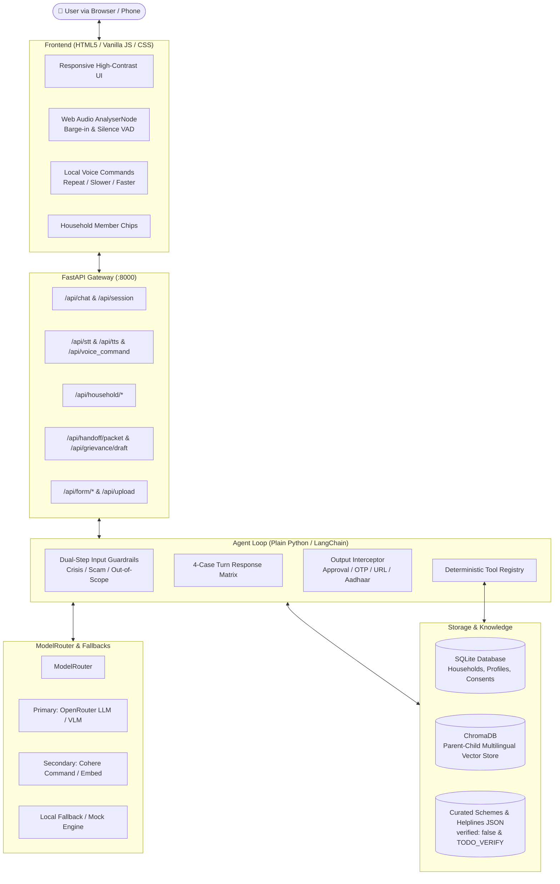
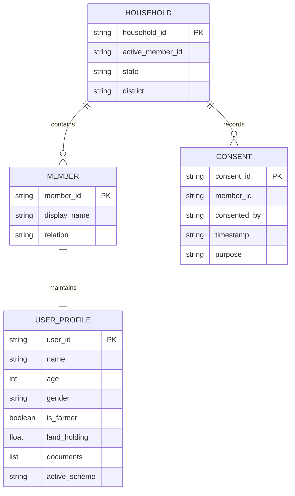

# Scheme Saathi – System Architecture

Scheme Saathi (योजना साथी) is an offline-capable, voice-first welfare scheme assistant designed specifically for low-literacy, rural, and underserved populations in India. The system bridges the accessibility gap by allowing users to explore government schemes, verify eligibility, check documents, receive plain-language explanations of rejections, and fill application forms via spoken voice in Hindi, English, Marathi, and Tamil.

---

## 1. High-Level Architecture Diagram



---

## 2. Component Subsystems

### 2.1 Voice Layer (Phase 8 & Phase 24)
- **STT (Speech-to-Text)**: Powered by AssemblyAI via `/api/stt` with PCM/WebM streaming chunks.
- **TTS (Text-to-Speech)**: Powered by Cartesia Sonic API (`sonic-latest`) using Indian accent voice models (`CARTESIA_VOICE_ID`) with browser Web Speech synthesis as an automated zero-downtime fallback.
- **Speech Formatter (`voice/speech_formatter.py`)**: Code-level deterministic text processor that transforms display text into speech-optimized transcripts:
  - Digit grouping with pauses: Aadhaar (4-4-4 grouping), 10-digit mobile numbers (5-5 grouping), bank account numbers.
  - Spoken currencies: Translates amounts (e.g. ₹6,000 $\to$ *"छह हज़ार रुपये"*).
  - Abbreviation expansion: Expands TTS-mangled terms (PM-KISAN $\to$ *"प्रधानमंत्री किसान"*, CSC $\to$ *"सीएससी"*, OTP $\to$ *"ओटीपी"*).
- **Audio Controls (`voice/commands.py`)**:
  - Deterministic matcher for voice commands: "repeat", "slower", "faster", "stop", "wait", "go back".
  - Entity confirmation: Deterministic binary classifier (`yes`/`no`) validating transcribed names, numbers, and dates.
- **Barge-In (Interruption Handling)**: Web Audio `AnalyserNode` monitors mic frequency volume during audio playback. When speech energy crosses threshold (>25 dB), playback is halted instantly and audio recording starts.

---

### 2.2 Dual-Layer Safety Guardrails (Phase 18)

```mermaid
sequenceDiagram
    autonumber
    actor User
    participant Loop as Agent Loop
    participant InGuard as Input Guardrails
    participant LLM as ModelRouter LLM
    participant OutGuard as Output Guardrails
    participant Helplines as Verified Helplines

    User->>Loop: User Utterance
    Loop->>InGuard: check_input(text)
    alt Crisis Detected (Self-harm, Violence, Medical, Hunger)
        InGuard-->>Loop: Crisis Flag (e.g. self_harm)
        Loop->>Helplines: format_crisis_response(crisis)
        Helplines-->>User: Immediate Emergency Helpline (112, 181, 1098, etc.)
    else Safe Input
        InGuard-->>Loop: Input Valid
        Loop->>LLM: invoke(messages)
        LLM-->>Loop: AgentTurn(content, tool)
        Loop->>OutGuard: check_output(content)
        alt Violation Found (Promise, OTP request, Unlisted URL)
            OutGuard-->>Loop: Sanitized Content + Violations
            Loop->>LLM: Correction Prompt (Retry once)
        else Clean Output
            OutGuard-->>Loop: Clean Content
            Loop-->>User: Spoken & Display Text (Aadhaar Masked)
        end
    end
```

1. **Pre-LLM Input Guardrails**:
   - Deterministic regex & keyword matcher detecting self-harm, domestic violence, child danger, medical emergency, hunger, scam phrases, and prompt injections.
   - Crisis queries bypass the LLM and deliver immediate verified helpline contact information.
   - Standing scam protection message delivered once per user session.
2. **Post-LLM Output Guardrails**:
   - Zero-tolerance blocking of approval promises (e.g. *"पक्का मिलेगा"*).
   - Blocks OTP, PIN, CVV, or full banking credential requests.
   - Enforces domain allowlist (`.gov.in`, `.nic.in`) to prevent phishing links.
   - Masks 12-digit Aadhaar numbers (`XXXX-XXXX-1234`).

---

### 2.3 Multi-Member Household Management (Phase 17)



- Enables multiple family members (self, spouse, mother, dependent children) within a single session.
- **Data Isolation**: Ensures attributes (such as land holdings or farmer status) are scoped strictly per member to avoid cross-contamination in eligibility checks.
- **Consent Logging**: Automatically creates timestamped `ConsentRecord` entries before recording profile data for another person.

---

### 2.4 Deterministic Benefit Ranking & Document Recovery (Phases 19 & 20)

- **Ranking Formulation**:
  $$\text{Score} = \frac{(\text{benefit})^{w_b} \times (\text{confidence})^{w_c}}{(\text{effort})^{w_e}}$$
  Weights adjust dynamically based on user persona (`balanced`, `highest_value`, `easiest`, `fastest`).
- **Missing-Document Recovery**:
  1. *Step 1*: Check accepted alternative documents (`find_accepted_alternatives`).
  2. *Step 2*: Topological dependency resolution (`get_acquisition_plan`) ensuring prerequisite documents (e.g., Aadhaar prior to Income Certificate) are acquired first.
  3. *Step 3*: Recommend alternative schemes reachable with currently held documents (`find_schemes_by_documents`).

---

### 2.5 Scheme Freshness & Verification Pipeline (Phase 23)

- **SHA-256 Hash Auditing**: `python -m scripts.refresh_schemes` downloads official portal metadata and detects upstream policy modifications.
- **Isolated Staging**: Changes are written to `data/pending/` with Markdown diff reports; live indices are never modified automatically.
- **Human-in-the-Loop Review**: `python -m scripts.review_updates` permits administrators to review, approve, or reject diffs before re-ingesting into ChromaDB.
- **Truth Integrity**: All unverified figures in JSON schemas use literal `"TODO_VERIFY"` and `verified: false`. Runtime speech formatter and agent loop refuse to fabricate unverified figures.
